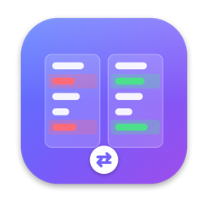
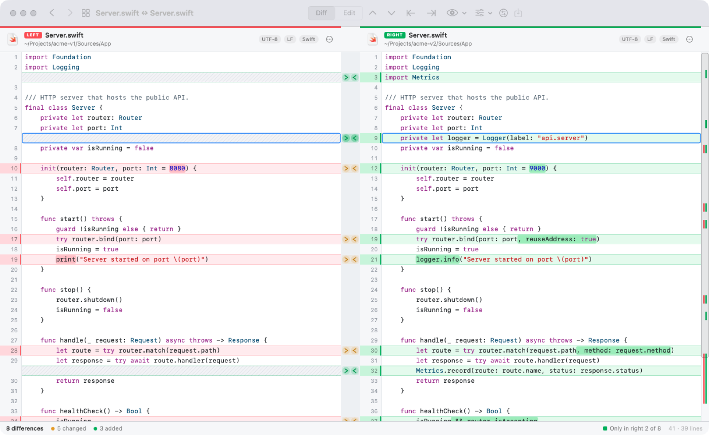
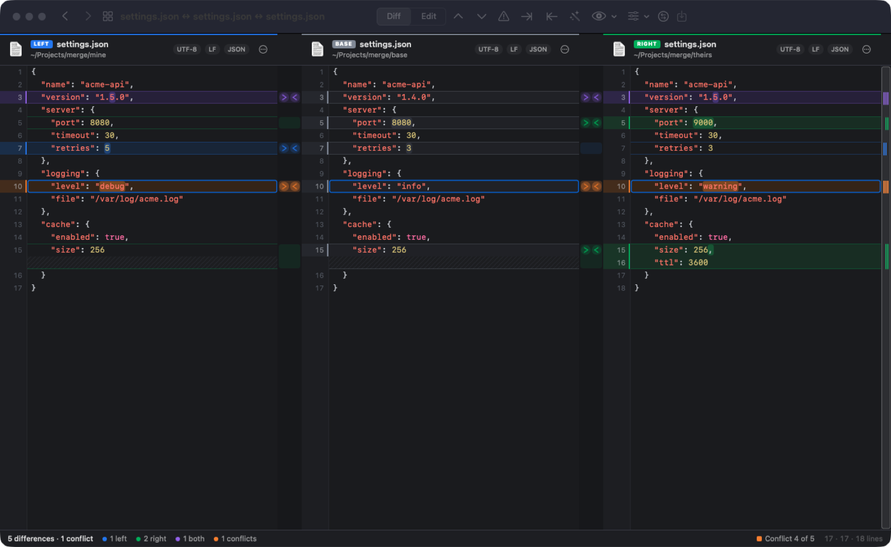
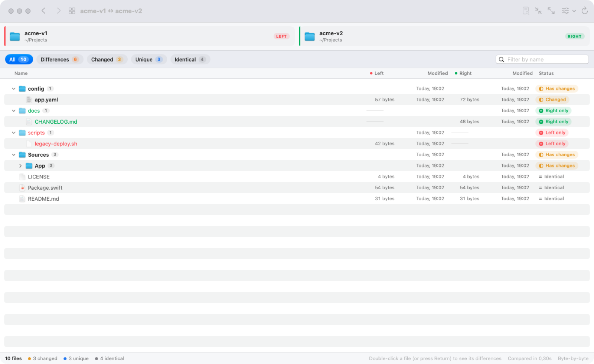
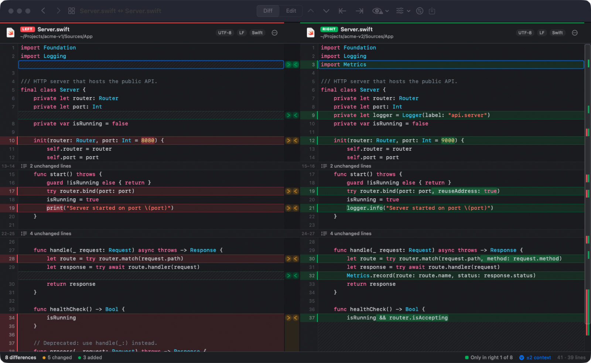

<div align="center">



# FileComparator

**Compare and merge files and folders on your Mac. Fast, native, and easy to read.**

A WinMerge-style diff and merge tool built for macOS. It handles two-way and
three-way comparisons of text, folders, images and binary files.

[](../../releases/latest)
&nbsp;
[](#-install)
&nbsp;

[](LICENSE)



</div>

---

## ✨ What it does

Drop two or three files or folders on the window. You see what changed right away.

- **Every line lines up.** Matching lines stay level across the panes. Gaps are shown
  where lines were added or removed.
- **The exact change inside a line is highlighted.** Word level, character level, or
  off.
- **Merge with one click.** Arrows between the panes copy a change across. Edit any
  line in place. Undo and redo work as you expect.
- **Fast on big files.** A 60,000-line file with a thousand differences opens
  instantly. The view draws only the rows on screen.

---

## 🔀 Three-way merge

Open **mine · base · theirs**. Every change is labelled as one of:

- a left change
- a right change
- the same change on both sides
- a **conflict**

**Auto-merge** takes every change that does not conflict into the base in one step.
Then you only step through the conflicts that are left (⌃⌥↓).

<div align="center">

</div>

---

## 📁 Folder compare

Compares two or three folder trees, byte by byte, in parallel. You can:

- **filter** the list: Differences, Changed, Unique, or Identical
- **search** files by name
- **open any file** to see its diff: double-click, press Return, or use the row's
  **Compare** button
- **go back and forward** with ⌘[ / ⌘], your mouse's back and forward buttons, or a
  swipe
- **open a file that exists on one side only** next to an empty pane. Saving that pane
  creates the missing file
- **copy** files and folders between sides, **reveal** them in Finder, or **move them to
  Trash**

<div align="center">

</div>

---

## 👀 Show only what matters

| View | What you see |
|---|---|
| **All lines** | Both files in full |
| **Changes with context** | Each difference, plus ±1, 3, 5, 7, 10 or 25 lines around it |
| **Changes only** | Just the differences |

Hidden lines collapse into a **"⋯ 53 unchanged lines"** bar. Click it to expand.
Click **"Hide…"** to fold it back up.

<div align="center">

</div>

More view options:

- **Long lines.** If a change is scrolled out of view, a coloured ‹‹ / ›› marker at the
  edge of the pane points to it. Click the marker to jump there.
- **Show whitespace.** Spaces appear as `·` and tabs as `→`.
- **Ignore options:** whitespace (three levels), case, blank lines, and numbers.
- **Diff algorithm:** Patience (easier to read) or Myers (smallest diff).
- **Display:** syntax colouring for about 25 languages, line numbers on or off, and
  light & dark mode.

---

## 📋 Paste and compare

No files? Click **Paste Text** (⇧⌘N, or ⌥⇧⌘N for three panes). You get empty editors:

- **Paste or type** into each pane. Changes are highlighted as you go.
- Press **⌘E** to switch to the aligned diff view.
- **Save** a pane to a file whenever you want.

---

## 🖼 Images and binaries

- **Images:** side by side, swipe, onion skin, and a difference heat map. It also tells
  you what percentage of the pixels changed.
- **Binary files:** where the first difference is, plus a side-by-side hex and ASCII
  view with the changed bytes highlighted.

---

## 🚀 Install

### With Homebrew (easiest)

```sh
brew install --cask oleksii-stepanenko/tap/file-comparator
```

This also installs the `fcompare` command.

### Or download it

**[Download the latest `.dmg`](../../releases/latest)**, open it, and drag
**FileComparator** into your **Applications** folder.

---

## 🔓 First launch

FileComparator is **not notarized** by Apple, because notarization needs a paid Apple
Developer account. So macOS blocks it the first time. This is normal. To open it:

1. Double-click **FileComparator**. macOS will refuse.
2. Open **System Settings → Privacy & Security**.
3. Scroll down to **Security** and click **Open Anyway**.
4. Confirm with Touch ID or your password.

You need to do this once per update.

---

## ⌨️ Command line

```sh
fcompare old.txt new.txt                 # two files
fcompare mine.txt base.txt theirs.txt    # three-way merge (the middle file is the base)
fcompare dir-a dir-b                     # two folders
fcompare --paste                         # empty panes to paste into (--paste 3 for three)
```

Use it as your **git difftool**:

```sh
git config --global difftool.fcompare.cmd 'fcompare "$LOCAL" "$REMOTE"'
git difftool --tool=fcompare
```

---

## ⌨️ Keyboard

| Keys | Action |
|---|---|
| ⌥↓ / ⌥↑ | Next / previous difference |
| ⌃⌥↓ / ⌃⌥↑ | Next / previous conflict |
| ⌥→ / ⌥← | Copy the current change right / left (three-way: take left / right into the base) |
| ⇧⌘M | Auto-merge all changes that do not conflict |
| ⌘1 / ⌘2 / ⌘3 | All lines / changes with context / changes only |
| ⌥⌘0 | Fold every expanded section back up |
| ⌥⌘W | Show whitespace |
| ⌘E | Switch between the diff and the text editors |
| ⌘[ / ⌘] | Back / forward (mouse buttons and swipe work too) |
| ⌘S · ⌘Z · ⇧⌘Z | Save · Undo · Redo |
| ⌘R | Reload / rescan |
| ⌘+ / ⌘- / ⌘0 | Font size |

---

## 🔨 Build it yourself

You need macOS 14 or newer and Xcode 16 or newer.

```sh
git clone https://github.com/oleksii-stepanenko/file-comparator.git
cd file-comparator

./Scripts/build.sh                  # builds build/FileComparator.app
open build/FileComparator.app
```

Run the tests:

```sh
swift test
```

The tests cover the diff engine:
- every diff is a valid edit script;
- Myers output is minimal;
- three-way classification and auto-merge;
- the view-mode folds;
- the ignore options;
- folder comparison;
- a 60,000-line performance check.

---

## 📁 What is inside

```
file-comparator/
├── Sources/
│   ├── DiffCore/          the engine — no UI, fully tested
│   │   ├── LineDiff       Myers (linear space) + Patience anchoring
│   │   ├── Comparison     2-way alignment, diff3, auto-merge
│   │   ├── InlineDiff     word / character level changes inside a line
│   │   ├── DisplayLayout  folds for the "changes only" views
│   │   └── FolderComparison  parallel folder scanner
│   └── FileComparator/    the app (SwiftUI + a custom AppKit diff renderer)
├── Tests/                 engine tests
├── Scripts/
│   ├── build.sh           builds the .app
│   ├── fcompare           the command-line launcher
│   └── make_icon.swift    draws the icon
├── packaging/             Homebrew cask + bump script
└── .github/workflows/     tag → build → .dmg → release → cask bump
```

Releasing a new version: `git tag v1.0.1 && git push origin v1.0.1`.

---

<div align="center">

**[Download](../../releases/latest)** ·
**[Report a problem](../../issues)**

Made for macOS. [MIT licensed](LICENSE).

</div>
